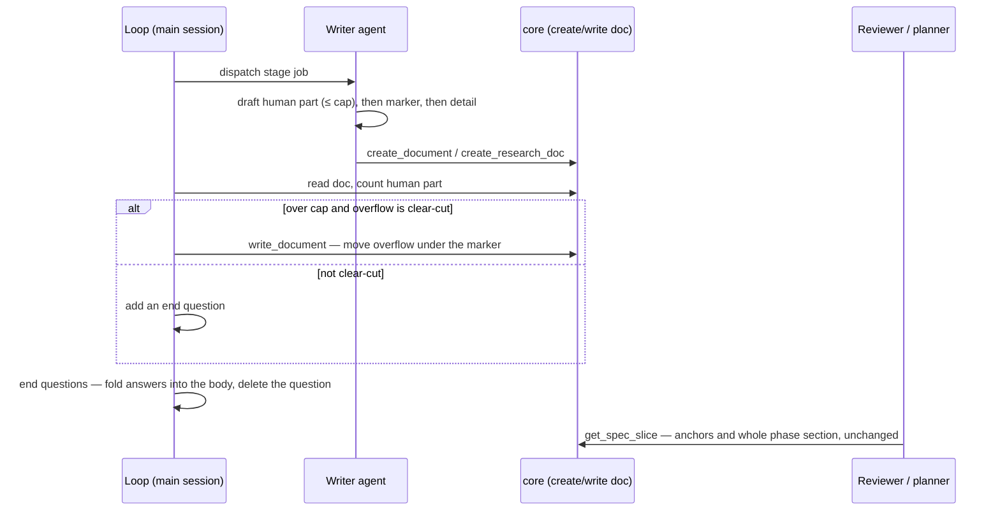

## At a glance

- **What:** prompt edits to the 6 doc-writing agents and both loops, 2 new shared snippets, ~12 new `selftest-prompts` rows, and a one-regex fix in `core/spec-slice.ts`. No board, gate or staleness change.
- **How detail moves:** each doc gets a short human part and one marker heading after which detail is uncapped. Builder docs use `## Details for agents`, research docs `## Appendix`, plans `### Task details` inside each phase.
- **Nothing parsed breaks:** every marker sits where the existing parsers (reviewer slice, `parseBuildList`, `**Exit test:**` line, INV-56 lists) already tolerate it (D1, D2).
- **Decided here:** PRD Q1–Q5 are resolved in the Decisions table (D3–D7).
- **For you to decide:** nothing blocking. Two small risks are listed at the end.
- **Top risk:** `INV-37` is already at its max of 4, and `INV-36b`'s 2 both sit in the builder. New designer text must avoid those phrases (R5).

## Summary

The PRD (`prd-readable-docs-048`) asks for short, decision-first docs with no fact lost. The fix lives almost entirely in prompts: a shared readability snippet carried by the 5 markdown writers, a shared design-pass snippet carried by the designer and the researcher's Docs job, per-agent caps, and a cap check in both loop reviews. `selftest-prompts` pins each new rule so it cannot silently drift. One core change fixes `matchPhaseHeading`, which cuts hyphenated phase names short.

## Flow



## Decisions

| # | Decision | Why | Ref |
|---|---|---|---|
| D1 | Builder detail marker is a plain `## Details for agents`; R-sections and component sections stay at `##` after it | Anchors and `sliceAt` work unchanged; no re-nesting | R2 |
| D2 | First section is the at-a-glance: `## At a glance` for PRD and Architecture; the plan's Overview; the walkthrough's Stakeholder test guide; the market `## TL;DR`; other research docs open each section with "So what:" | Keeps INV-50a/b, INV-56 lists and the loop's Overview check intact | R2, R4 |
| D3 | Over-cap is a review finding, not a hard failure. Clear-cut overflow is moved under the marker by the loop; otherwise it becomes an end question (PRD Q1) | The loop approves before review and never sends a doc back | R7 |
| D4 | Builder caps count non-blank body lines before the marker; research caps count words before `## Appendix`, `## Sources` excluded; plan caps are per element (PRD Q2) | One deterministic measure per doc family | R3, R7 |
| D5 | Research docs get no `## At a glance` heading; the market TL;DR is the decision summary (PRD Q3) | Pinned lists stay the first headings | R4 |
| D6 | Reviewer and walkthrough-writer need no change (PRD Q4) | `### Task details` is inside the phase section the slice takes; Architecture detail is reached by anchor wherever it sits | R3 |
| D7 | Design-grounding drift ships here as a snippet-header note only (PRD Q5) | INV-15a already passes; the planner's adapted framing is what INV-15's comment allows | R2 |
| D8 | Planner loop-mode decisions go to a `## Decisions` list, not Open questions; the loop reads both | Open questions then holds only open items | R6 |
| D9 | `matchPhaseHeading` stops at whitespace or `—` only, then strips trailing `-` | Real plans use `loop-docs` and `viewer-parity` | R8 |

## Risks and open questions

- **Cap counting by the loop is model-run.** D4 makes it deterministic, but the loop still has to run it. Assumption: the loop counts with one `awk` over the doc's `filePath`, skipping frontmatter.
- **Browser tools may be absent** for the render check (R5). Assumption: no browser tool means a static check of fixed widths and non-wrapping rows, noted in the agent's report, never a failure.
- **Success is measured by re-running loops** on a sample (PRD Success metrics). That run is a walkthrough step, not a task.

## Details for agents

### Affected components

| File | Change | Ref |
|---|---|---|
| `docs/agent-snippets/lossless-carryover.md` | add the "reachable" line | R1 |
| `docs/agent-snippets/readable-doc.md` (new) | shared readability rule | R2 |
| `docs/agent-snippets/design-pass.md` (new) | shared design pass + self-critique | R5 |
| `docs/agent-snippets/design-grounding.md` | header names the planner's adapted framing | R2 |
| `plugins/specmanager/agents/prd-writer.md` | snippets, cap, marker | R1–R3 |
| `plugins/specmanager/agents/architect.md` | snippets, section order, cap | R1–R3 |
| `plugins/specmanager/agents/planner.md` | snippets, plan caps, Decisions list | R1–R3, R6 |
| `plugins/specmanager/agents/walkthrough-writer.md` | snippets, walkthrough caps | R1–R3 |
| `plugins/specmanager/agents/researcher.md` | snippets, research rules, Docs copy, design pass | R1–R5 |
| `plugins/specmanager/agents/designer.md` | design pass, mockup notes | R5 |
| `plugins/specmanager/commands/specmanager-loop.md` | cap check, fold answers, Decisions | R6, R7 |
| `plugins/specmanager/commands/specmanager-research-loop.md` | cap check, Appendix allowed, fold answers | R6, R7 |
| `plugins/specmanager/server/src/core/spec-slice.ts` | regex fix | R8 |
| `plugins/specmanager/server/src/selftest-specslice.ts` | hyphen cases | R8 |
| `plugins/specmanager/server/src/selftest-prompts.ts` | Part I rows | prompt-invariants |

Unchanged: `agents/reviewer.md`, `agents/builder.md`, `commands/specmanager-research.md`, `commands/specmanager-design.md`, `core/active-card.ts` (it imports the fixed parser), all of `ui/`.

## R1 — Keep every fact, reachable

- The density blockquote stays byte-identical in all 5 carriers (INV-13, INV-29). A second blockquote line follows it, in the snippet and all 5 carriers in one commit:
  `> Survive means *reachable*: a fact already in an upstream doc survives by its id — don't copy it. Put each fact once, in the doc that owns it. Detail a reader doesn't need to decide goes under the details section at the end — never out of the doc.`
- Pinned by a new row (INV-66, 5..5).

## R2 — Shared readability rule

New snippet `docs/agent-snippets/readable-doc.md`, same header style as `lossless-carryover.md`, carried verbatim by prd-writer, architect, planner, walkthrough-writer and researcher. Its body, as bullets:

- Open with your doc's at-a-glance section (named per agent, D2): ≤12 lines, plain words — what it is, decisions made, what the reader must decide, top risks.
- Tables ≤5 columns, short cells, ids in the last column. ≤2 ids per sentence.
- One idea per paragraph, ≤3 sentences; bullets one level deep.
- Cite as `[n]` with one Sources list.
- Never write "this doc", "per the brief", version numbers or loop mode.
- A rewrite states what is true now: fold answers in, delete resolved questions, no changelog or review-history sections (git holds history).

Per-agent placement of the human part and marker:

| Agent | At-a-glance | Marker | Ref |
|---|---|---|---|
| prd-writer | `## At a glance` | `## Details for agents` (optional) | D1, D2 |
| architect | `## At a glance` | `## Details for agents` | D1 |
| planner | Overview | `### Task details` per phase | R3 |
| walkthrough-writer | Stakeholder test guide | none (whole doc capped) | INV-50 |
| researcher | market TL;DR / "So what:" leads | `## Appendix` | R4 |

Architect section order becomes: At a glance, Summary, Flow (one mermaid `sequenceDiagram`), Decisions, Risks and open questions — then `## Details for agents` with Affected components, Data model, Interfaces, R-sections, Failure & edge cases, Conventions. The anchor convention text is unchanged. Amendments are merged into the body, never listed on top.

Design-grounding (D7): the snippet header gains one sentence saying carriers may adapt the framing around the pinned method clause, naming the planner's "Ground phases/tasks in it" framing. No agent text changes.

## R3 — Caps on the human part

| Doc | Cap | Measure (D4) |
|---|---|---|
| PRD | ≤120 lines; files, tests and endpoints belong to Architecture | non-blank lines before marker |
| Architecture | ≤150 lines; one mermaid sequence diagram | non-blank lines before marker |
| Plan | Overview ≤5 lines; exit test one `**Exit test:**` line + optional italic caveat line (≤3 total); Notes ≤25 words | per element |
| Walkthrough | ≤200 lines; exit criterion quoted once; one line per pass criterion; samples ≤6 lines; troubleshooting ≤6 rows | non-blank lines, whole doc |
| Research brief / market / marketing / user research / strategy | 600 / 1,500 / 1,500 / 2,000 / 800 words | words before `## Appendix`, `## Sources` excluded |

Plan specifics:

- A Notes cell over 25 words moves to `### Task details` inside the same phase section, after the task table, as `- **n.m** — …`.
- `### Task details` must contain no `---` line and no `##` heading: `planSectionFor` ends the phase there.
- The `**Exit test:**` stays one line: `exitTestForPhase` (`core/active-card.ts`) reads only that line for the Stop-gate fallback.
- prd-writer line 22's "≤250 lines" is replaced; planner, walkthrough-writer and researcher replace "Keep it tight" style lines with their cap.

Walkthrough specifics: line 32 keeps one verbatim blockquote of the exit criterion; line 36 becomes "one check per claim in the exit criterion"; line 37 becomes "one line per check, citing its number". The emit order and pinned strings (INV-50a–e) are untouched.

## R4 — Research docs lead with the decision

- `## TL;DR` (market): the decision in one sentence, then 3–5 bullets with one number each.
- Every section opens with a `So what:` line.
- The brief is referenced by `brief-<slug>`, never pasted.
- `market-merge` (researcher.md:83): picks one figure per metric for the body and moves the other, with its source, to `## Appendix`. It no longer keeps every section-job figure in the body.
- Market, marketing and user-research lists gain a last line `- `## Appendix` — optional: …`. Placed after the list's last line, so INV-56a/c/d still match (they anchor on consecutive lines, not on what follows).
- Gaps: one legend line may say unsourced cells read `n/a`; this must not reuse the exact backticked `n/a (unsourced)` string (INV-57b is pinned 6..6) nor the phrase "never invent" (INV-57a 3..3, INV-64g 3..3).
- The `[V]/[A]/[D]` tag legend moves to `## Appendix`. Kill signals and V1 decision rules stay in the body.

## R5 — Design pass and HTML copy

New snippet `docs/agent-snippets/design-pass.md`, carried by `agents/designer.md` and the researcher's "Every Doc" block:

- Call `Skill` with `frontend-design:frontend-design` before building. If it is not available, apply the fallback method and continue.
- Pick a deliberate aesthetic direction, a type scale with a display size ≥32px, and a grid. Add a chart where numbers compare. Avoid the system-font, default-purple, 11px-uppercase-label template.
- Self-critique: render at 1200px and 720px with any available browser tool; fix overflow, filler, notes that outweigh screens, and a generic look. No browser tool: check fixed widths and non-wrapping rows by reading the HTML.

Designer specifics:

- Replace line 28's "if installed, defer to it" with the snippet. Keep "No vendoring" once (INV-36a) and the five fallback elements once each (INV-14a–e).
- New designer text must not contain "source of truth", "trace to a DESIGN.md token" (INV-37 is at max 4) or "graceful degradation" (INV-36b at max 2).
- Line 69 notes: `<h2>` ≤8 words, ≤60 words on what and why; builder detail in `<details><summary>Build notes</summary>` (works with scripts disabled). Open questions: unresolved only, ≤6. Never print the method in the file. Each state once; a light/dark twin only when it differs in more than colour. Rows use `flex-wrap`.

Researcher Docs specifics: headline ≤8 words, one message per slide or section, ≤40 words of body, no ids or process text, sources in a footer. Decks run 8–12 slides (title, problem, solution, proof, market, model, ask) with takeaway headlines. Title (line 91) becomes a human title, e.g. "Pesso — Lanzadera update". Safe: the doc slug comes from `docType`, not the title (`core/research.ts` `slugify(docType)`). The researcher's copy of the fallback elements is not pinned by INV-14 (designer-only).

## R6 — Loop end questions fold in

- `specmanager-loop.md` step 11 and `specmanager-research-loop.md` step 12: "answered entries are removed from, or marked resolved in" becomes "answered entries are deleted and the answer is folded into the body".
- Planner line 19 and the loop-mode rule string at `specmanager-loop.md:100`: loop-mode decisions go to `## Decisions` (one line each: decision · alternative not taken). Step 11 gathers `## Decisions` alongside Open questions (D8).

## R7 — Loops check the caps

- `specmanager-loop.md` step 10 gains one bullet: each doc's human part is within its R3 cap, counted per D4.
- `specmanager-research-loop.md` step 11 gains the same bullet, and the pinned-headings bullet allows an optional trailing `## Appendix`.
- Over cap (D3): move clear-cut overflow under the marker with the existing write rules; HTML Docs keep the "small textual edits only" rule, so an over-long Doc becomes an end question.
- New text avoids the INV-64g phrases and adds no "Don't approve" or `set_status(` (INV-64a/b).

## R8 — Phase-heading hyphen fix

```ts
export function matchPhaseHeading(line: string): string | null
// /^##\s+Phase\s+([^\s—]+)/i, then strip trailing "-"; empty ⇒ null
```

- `## Phase loop-docs — X` ⇒ `loop-docs`; `## Phase core — X` ⇒ `core`; `## Phase core - X` ⇒ `core`; `## Phase core—X` ⇒ `core`.
- Both callers (`planSectionFor`, `exitTestForPhase`) inherit the fix; the doc comment is updated.
- `selftest-specslice.ts` adds asserts for the four cases next to the existing three, plus one `getSpecSlice` case where `planSection` resolves for a hyphenated phase.

## Prompt invariants

A new block, Part I (INV-66 onward), is appended after INV-65 in `selftest-prompts.ts`; the header comment lists it.

| Row | Pins | Files | Count |
|---|---|---|---|
| INV-66 | the "Survive means *reachable*" line | 5 density carriers | 5..5 |
| INV-67a–c | readable-doc key sentences (at-a-glance ≤12 lines; fold answers / no changelog; ≤2 ids per sentence) | 5 carriers | 5..5 each |
| INV-68a/b | design-pass `Skill` call; 1200px and 720px render | designer, researcher | 2..2 each |
| INV-69 | `## Appendix` optional line | researcher | 3..3 |
| INV-70a/b | cap check bullet | each loop | 1..1 |
| INV-71 | negative: "marked resolved in" | both loops | 0..0 |
| INV-72 | `<details><summary>Build notes</summary>` | designer | 1..1 |
| INV-73 | `### Task details` with the no-`---` rule | planner | 1..1 |

Every pinned sentence is copied from the snippet, so INV-67/68 double as snippet parity. Each snippet's header names its carriers.

## Failure & edge cases

- **Marker collides with an anchor or phase name:** `## Details for agents` has slug `details-for-agents`. The planner must never cite it, and fallback tier 2 would only match a phase named `details`, `for` or `agents`. Planner text says so in one clause.
- **`---` or `##` inside `### Task details`:** truncates the reviewer slice. Prevented by R3's rule and INV-73.
- **Mermaid in a fence:** headings are not fence-aware (`selftest-specslice` case 12). Sequence diagrams carry no `##` lines, so nothing truncates.
- **Unsourced draft notice:** stays the first line of a research doc, above the TL;DR.
- **Old plans with a hyphenated suffix** (`## Phase A-theme`) would now read `A-theme`. None exist in this repo's plans; `viewer-parity` and `loop-docs` are the real cases and now resolve.
- **Over-cap HTML Doc:** never restructured by the loop (R7).
- **`frontend-design` missing:** fallback method, no error.

## Conventions used

- Snippet rule: change the fragment in `docs/agent-snippets/` and every carrier in one commit; `selftest-prompts` pins the parity.
- Pinned counts are exact; re-pin deliberately in the same commit, never loosen to pass.
- TypeScript ESM, Node 20+; self-tests are hand-rolled `assert` scripts run as `npm run selftest-*`.
- No model or API calls from the plugin: the `Skill` call runs inside the agent.
- Release: minor bump 1.5.0 → 1.6.0, rebuild `server/dist` (`ui/dist` unchanged), `selftest-directory`, `claude plugin validate`. No packaging change, so no surface test.
- Existing docs in any project are not rewritten.
